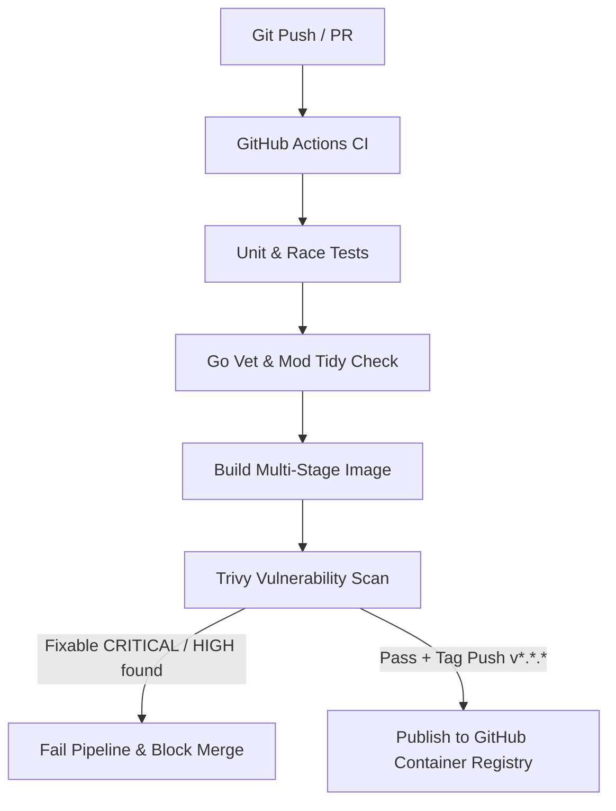

# healthd

[](https://github.com/neyfua/healthd/actions/workflows/ci.yml)
[](https://github.com/neyfua/healthd/actions/workflows/container.yml)

A minimal, production-grade Go HTTP health probe showcasing an automated container delivery pipeline: code testing, multi-stage compilation, security scanning, and container registry publishing.

## Architecture



## Features

- **Standard Library Only**: Fast startup, zero third-party runtime dependencies, small footprint.
- **Graceful Lifecycle**: Handles `SIGTERM` and `SIGINT` with 5-second shutdown context.
- **Hardened Distroless Base**: Runs as unprivileged user (`nonroot:65532`), eliminating package managers and shells from production images.
- **Security Guardrails**: Automated Trivy scanning blocks deployment if fixable critical or high vulnerabilities are detected.
- **Automated OCI Releases**: Semantic version tags publish multi-tagged images (`vX.Y.Z`, `vX.Y`, `sha-*`) to GitHub Container Registry (`ghcr.io`).

## Endpoints

- `GET /health` - Health probe returns `200 OK` with `{"status":"ok"}`.
- `GET /` - Root endpoint returns service identification and version metadata.

## Local Development

### Prerequisites

- Go 1.25 or newer
- Make
- Docker & Docker Compose (optional for local containers)

### Run & Test

```bash
# Run unit tests
make test

# Build binary
make build

# Run binary locally
make run

# Query endpoint
curl -i http://localhost:8080/health
```

### Run with Docker Compose

```bash
docker compose up --build -d
curl http://localhost:8080/health
docker compose down
```

## Continuous Integration & Delivery

1. **Pull Requests (`ci.yml` & `container.yml`)**:
   - Runs unit tests with race detection and test shuffling.
   - Verifies Go module consistency (`go mod tidy --diff`).
   - Builds container image and runs Trivy vulnerability scanning.
2. **Releases (`container.yml`)**:
   - Triggered on Git tags matching `v*.*.*`.
   - Generates semver and git-SHA tags.
   - Authenticates to `ghcr.io` via repository token.
   - Publishes signed container images to GitHub Packages.

## Creating a Release

```bash
git tag v0.1.0
git push origin v0.1.0
```

Images can then be pulled via:

```bash
docker pull ghcr.io/neyfua/healthd:v0.1.0
```
